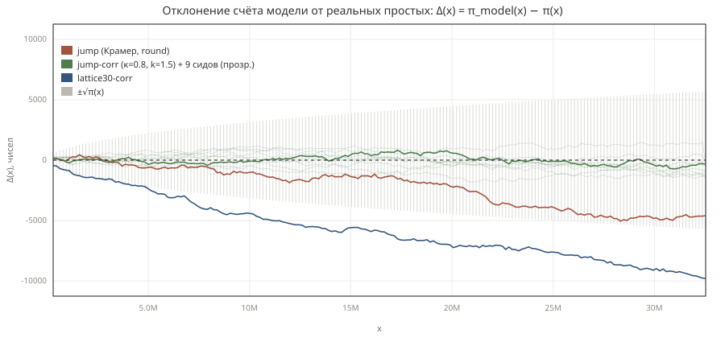
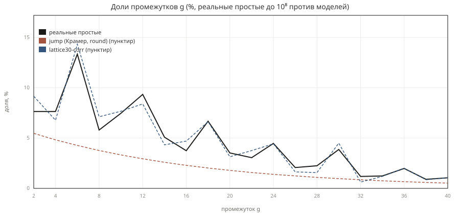
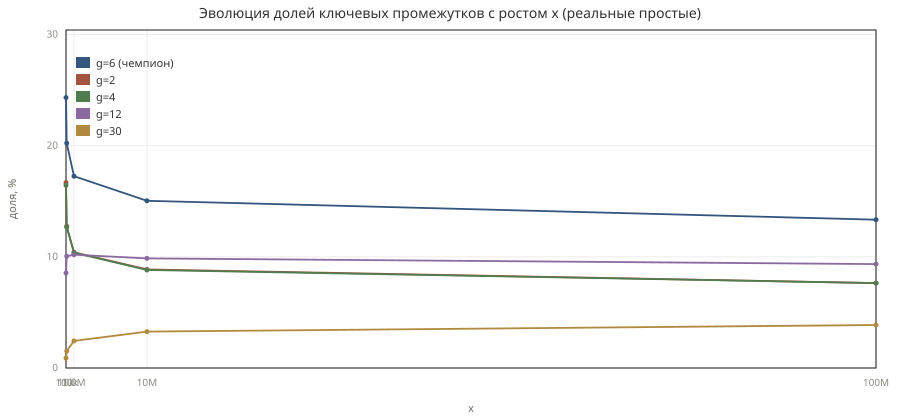
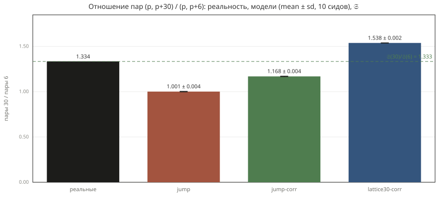
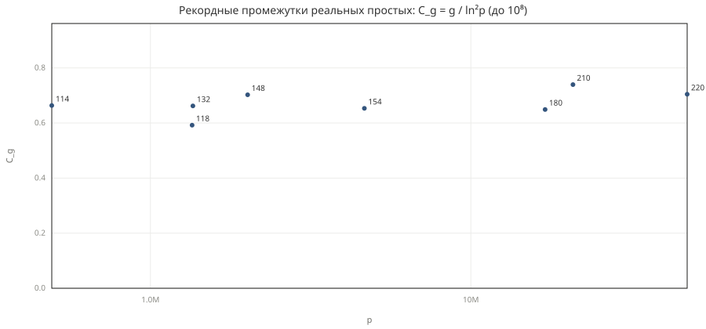

# Псевдопростые: что модель Крамера умеет, а что нет — и как мы это починили

*Экспериментальное мини-исследование на генераторе из `src/core/sequence.mjs` и реальных простых до 10⁸. Все числа воспроизводимы: скрипты и команды — в конце статьи.*

---

## 1. Две случайности: настоящие и «нарисованные» простые

Настоящие простые числа детерминированы, но по всем статистическим признакам ведут себя как случайные — с точностью, которая до сих пор не выведена из аксиом. Классическая **модель Крамера** (1936) играет в ту же игру: каждое число `x > 1` объявляется простым с вероятностью `1/ln x`. В нашем генераторе это реализовано чуть иначе, но эквивалентно: следующий элемент ставится на расстоянии ~`ln x` от предыдущего (режим `jump`), что даёт ту же плотность `1/ln x`.

Вопрос, который мы исследуем: **какие свойства настоящих простых эта модель воспроизводит, какие — ломает, и какие «ручки» нужно добавить, чтобы закрыть разрыв**. Эталон — настоящие простые до 10⁸ (5 761 455 чисел, последнее 99 999 989), посчитанные сегментированным решетом (`src/core/real-primes.mjs`, ~0.3 с).

## 2. Метод

- **Модель:** n = 2 000 000 элементов на прогон, 10 сидов, tolerance 1e-10, режим `jump` с ручками: `twinRate` κ (инъекция близнецов), `gapShape` k (форма промежутков гамма-распределением), `lattice6` / `lattice30` (удержание вычетов mod 6 / mod 30).
- **Реальность:** решето до 10⁸; на каждом x — точное π(x).
- **Статистики** (те же формулы, что в UI): средний промежуток, `twinIndex = (доля двоек) · средний промежуток`, дисперсия `var/mean²`, гистограмма промежутков, гистограмма промежутков mod 6, гонки Чебышёва Δ₄ = π(x;4,3)−π(x;4,1) и Δ₆ = π(x;6,5)−π(x;6,1), рекордные промежутки C_g = g/ln²p, пары (p, p+g) против сингулярной серии Харди—Литтлвуда.

Четыре конфигурации, которые мы будем сравнивать с реальностью:

| Конфигурация | Ручки | Что пытается починить |
|---|---|---|
| `jump` | — | чистый Крамер |
| `jump-corr` | κ=0.8, k=1.5 | близнецы + сгущения |
| `jump-lattice6-corr` | lattice6, κ=2.1, k=1.45 | + гистограмма mod 6 |
| `jump-lattice30-corr` | lattice30, κ=3.4, k=1.4 | + гистограмма mod 30 |

## 3. Плотность: то, что модель умеет с самого начала

Первый сюрприз для новичка: **сколько** простых на отрезке — модель угадывает почти идеально. Разница счёта модели и реальности Δ(x) = π_model(x) − π(x) остаётся внутри полосы ±√π(x) — то есть неотличима от чистой случайности на том же объёме данных (рис. 1).


*Рис. 1. Δ(x) для трёх моделей: чистый jump, jump-corr и lattice30-corr. Серая полоса — ±√π(x).*

На n = 2 000 000 (x_max ≈ 3.2·10⁷) перебор/недобор модели против реального π(x_max):

| Конфигурация | n − π(x_max) | Относительная ошибка |
|---|---|---|
| jump | −3 249 ± 1 372 | −0.16% |
| jump-corr | −525 ± 859 | −0.03% |
| jump-lattice6-corr | +49 389 ± 730 | **+2.5%** |
| jump-lattice30-corr | −8 544 ± 1 188 | −0.43% |

**Урок №1:** плотность — самый лёгкий инвариант; она выживает при любых ручках. Исключение — решёточные связки: удержание вычетов стоит плотности (у lattice6 — +2.5%, «остаточный сдвиг» из-за асимметричной цепи состояний).

## 4. Гистограмма промежутков: модель не знает про число 3

У настоящих простых чемпионы промежутков — **g = 6** (13.34% всех промежутков до 10⁸), затем g = 2 (7.64%) и g = 4 (7.64%). Это прямое следствие решета: между кратными 3 вычетами ±1 mod 6 расстояние ровно 6.

Модель Крамера об этом не знает: её промежутки — округлённые экспоненциальные, и гистограмма монотонно падает (рис. 2): у чистого jump доля g=2 — 5.48%, g=6 — 4.30%, чемпион — двойка.


*Рис. 2. Доли промежутков g = 2…40: реальные простые против jump и lattice30-corr.*

Более того, у модели ~32% промежутков — **нечётные**, у реальных — 0.0% (после p=2 два нечётных простых подряд невозможны). Плотность одинакова, а дискретная фактура — принципиально другая.

**Урок №2:** гистограмма промежутков — уже не про плотность, а про структуру остатков; случайными скачками она не собирается.

## 5. Близнецы: константа Харди—Литтлвуда против инъекции

Мера «близнечности», инвариантная к плотности: `twinIndex = (доля двоек) · средний промежуток`. У настоящих простых до 10⁸ он равен **1.326** — практически константа Харди—Литтлвуда **2C₂ = 1.3203** (теоретическая асимптота плотности пар p, p+2).

| Конфигурация | twinIndex (mean ± σ, 10 сидов) | Отклонение от реальных |
|---|---|---|
| real (до 10⁸) | **1.326** | — |
| jump | 0.889 ± 0.003 | **−33%** |
| jump-corr (κ=0.8) | 1.348 ± 0.004 | +1.7% |
| jump-lattice30-corr (κ=3.4) | 1.493 ± 0.001 | +12.6% |

Интуитивная попытка «инъекция с константой 2C₂» (κ=1.3203) даёт twinIndex **2.094** — перелёт почти в полтора раза. Причина тонкая: дискретизация `round` при скачках уже сама по себе производит ~5.5% двоек, и рабочая константа инъекции оказывается ~0.5–0.8, а не 2C₂. Это хороший пример того, как дискретная реализация модели меняет смысл её непрерывного параметра.

**Урок №3:** близнецы закрываются одной ручкой (κ≈0.8), но «правильное» значение ручки — эмпирическое, не теоретическое.

## 6. Сгущения: гамма против экспоненты, и как ручки связаны

У реальных простых промежутки **сгущены**: дисперсия var/mean² = **0.727** < 1 (экспоненциальное распределение даёт ровно 1). Это следствие решета — «запреты» от маленьких простых исключают часть позиций и стягивают распределение.

Форма лечится гамма-распределением с параметром k: var/mean² = 1/k. Но ручки **связаны**:

- гамма сама по себе (k=1.45, `jump-cluster`) даёт дисперсию 0.696 ≈ идеал, но **убивает близнецов** (twinIndex падает до 0.633 — даже ниже чистого jump);
- инъекция близнецов сама по себе (κ=0.5) **поднимает** дисперсию до 1.051.

Совместная точка `jump-corr` (κ=0.8, k=1.5): twinIndex 1.348, дисперсия 0.738 — обе статистики в пределах ~4% от реальных одновременно.

**Урок №4:** статистики простых не независимы; лечить их нужно согласованно, и не каждая пара целевых значений достижима двумя ручками.

## 7. Решётка mod 6: починили гистограмму — сломали гонки

Настоящие простые > 3 живут в классах ±1 mod 6, поэтому их промежутки mod 6 распределены **43.9 / 28.1 / 28.1** (доли кратных 6 / ≡2 / ≡4). Чистый jump даёт 13.8 / 17.6 / 15.6 — без намёка на m0-доминирование.

Решёточная связка (`lattice6` / `lattice30`) удерживает элементы в разрешённых вычетах и закрывает гистограмму:

| Конфигурация | mod 6 (0 / 2 / 4), % | twinIndex | var/mean² | Δ₆ @ x_max |
|---|---|---|---|---|
| real | **43.9 / 28.1 / 28.1** | 1.326 | 0.727 | **530** |
| jump-corr | 14.5 / 21.4 / 15.7 | 1.348 | 0.738 | −226 ± 724 |
| jump-lattice6-corr | 52.0 / 24.0 / 24.0 | 1.353 | 0.708 | **+628 196 ± 1 008** |
| jump-lattice30-corr | **43.6 / 28.2 / 28.2** | 1.493 | 0.710 | +273 145 ± 720 |

`lattice30-corr` воспроизводит гистограмму mod 6 с точностью до десятых долей процента. Но цена видна в последнем столбце: **bias Чебышёва**. У реальных простых гонка Δ₆ = π(x;6,5) − π(x;6,1) застывает около +530 при x ≈ 3.3·10⁷ — лёгкий перевес вычета 5. У решёток цепь состояний асимметрична (доля вычета 5 mod 6 ≈ 0.657 вместо 0.500), и ложная гонка взрывается до сотен тысяч — в тысячу раз сильнее реальной, при том что гистограмма промежутков идеальна.

**Урок №5:** баланс вычетов — независимый структурный параметр. Он не фиксируется правилами уровня промежутков: гистограмма mod 6 и гонка по вычетам — разные инварианты.

## 8. Чемпионы меняются с ростом x: g=6 тает, g=30 растёт

Доли ключевых промежутков — не константы (рис. 3): доля g=6 монотонно падает с 24.3% (x=10⁴) до 13.34% (x=10⁸), а доля g=30 растёт с 0.90% до 3.87%. Чем крупнее масштаб, тем «размазаннее» гистограмма: ln x растёт, и большие промежутки набирают вес.


*Рис. 3. Доли g = 2, 4, 6, 12, 30 по Milestone'ам x = 10⁴ … 10⁷ (реальные простые).*

Практический вывод для генератора: у ручек не может быть «одних правильных значений» — κ и k приходится подстраивать под диапазон x.

## 9. Пары (p, p+30) и сингулярная серия: 1.334 против 1.333

Гипотеза Харди—Литтлвуда предсказывает число пар с расстоянием g пропорционально сингулярной серии 𝔖(g). Для отношения пар g=30 к g=6 она даёт **𝔖(30)/𝔖(6) = 1.333**. Замер на реальных простых до 10⁸: **1.334** (1 173 934 пары 30 против 879 908 пар 6). Совпадение до третьего знака — и это при том, что двойки-близнецы в каждой модели мы делали инъекцией.


*Рис. 4. Отношение пар (p,p+30)/(p,p+6): реальность, модели, предсказание 𝔖.*

Модели: чистый jump — 0.997 (корреляций нет), jump-corr — 1.171 (частично), lattice30-corr — 1.535 (решётка 30 переусиливает большие промежутки). Только модель, в которой структура остатков правильная, может рассчитывать на сингулярную серию — и то лишь по построению.

## 10. Рекорды промежутков: лестница с плато

Максимальные промежутки до 10⁸ — лестница с последним рекордом **g = 220 при p = 47 326 913** (C_g = g/ln²p = 0.704). Все рекорды ложатся в полосу C_g ≈ 0.59–0.74 без выраженного тренда (рис. 5) — в согласии с уточнением Крамера—Гранвилля (константа ~2e^{−γ} ≈ 1.12 как предел lim sup; наши 0.7 — пока «ниже крыши», на 10⁸ так и должно быть).


*Рис. 5. Рекордные промежутки реальных простых: точки (p, g), ступени C_g = g/ln²p.*

У чистого jump средний максимальный промежуток на прогоне — 242 ± 17, у скорректированных моделей 184–191 ± 11–16: сгущения (k > 1) снижают хвост — ещё одно подтверждение, что реальные простые «компактнее» экспоненты.

## 11. Что воспроизводится, а что нет — итог

| Инвариант | real (до 10⁸) | jump | jump-corr | lattice30-corr | Вердикт |
|---|---|---|---|---|---|
| π(x) (n−π на 2M) | 0 | −3 249 | −525 | −8 544 | ✅ плотность бесплатна |
| twinIndex | 1.326 | 0.889 | 1.348 | 1.493 | ✅ ручка κ≈0.8 |
| var/mean² | 0.727 | 1.002 | 0.738 | 0.710 | ✅ ручка k≈1.5, но связана с κ |
| чётные промежутки | 100% | 68% | 72% | 100% | ✅ только с решёткой |
| mod 6 гистограмма | 43.9/28.1/28.1 | 13.8/17.6/15.6 | 14.5/21.4/15.7 | 43.6/28.2/28.2 | ✅ lattice30 |
| autocorr ρ₁ | **−0.032** | +0.005 | +0.006 | −0.003 | ❌ у реальных лёгкая антикорреляция соседних промежутков, ручек нет |
| гонка Δ₆ (drift) | +0.272 | ~0 | ~0 | ложный +129…+302 | ❌ bias живёт на уровне вычетов, не промежутков |
| пары 30/6 | 1.334 | 0.997 | 1.171 | 1.535 | ⚠️ сходится только с 𝔖-структурой |

Итого: **плотность, близнецы, сгущения и решёточная гистограмма воспроизводимы ручками ядра; антикорреляция промежутков и баланс вычетов (bias Чебышёва) — нет**: они живут на уровне решета остатков целиком, а не на уровне локальных правил.

## 12. Воспроизведение

```bash
# данные: решето до 1e8 + 4 конфигурации × 10 сидов (быстрый прогон: --quick)
node scripts/article-data.mjs          # → results/article-data.json
node scripts/make-figures.mjs          # → article/figures/fig1..fig5.svg

# расширенное сравнение (11 режимов, гонки Δ₄/Δ₆, решето до 3.3e7)
node scripts/compare-model-reality.mjs # → results/model-vs-reality.md
```

Ключевые файлы: генератор и ручки — `src/core/sequence.mjs`; решето — `src/core/real-primes.mjs`; сборка данных — `scripts/article-data.mjs`; графики — `scripts/make-figures.mjs`. Ручки доступны и в UI (чекбоксы решёток, слайдеры twinRate/gapShape) и через CLI (`node scripts/cli.mjs --help`).
